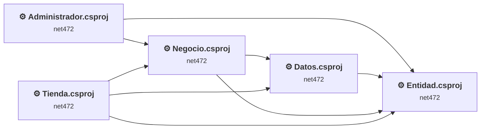
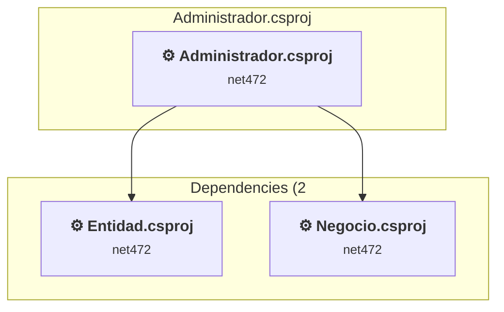
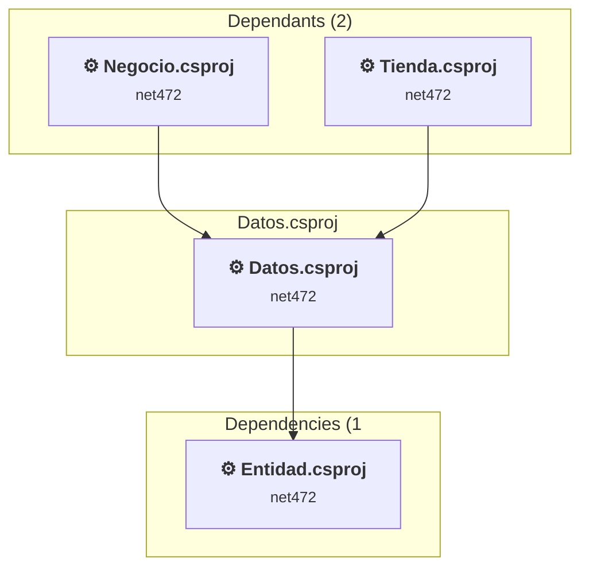
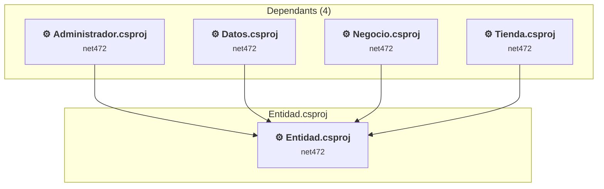
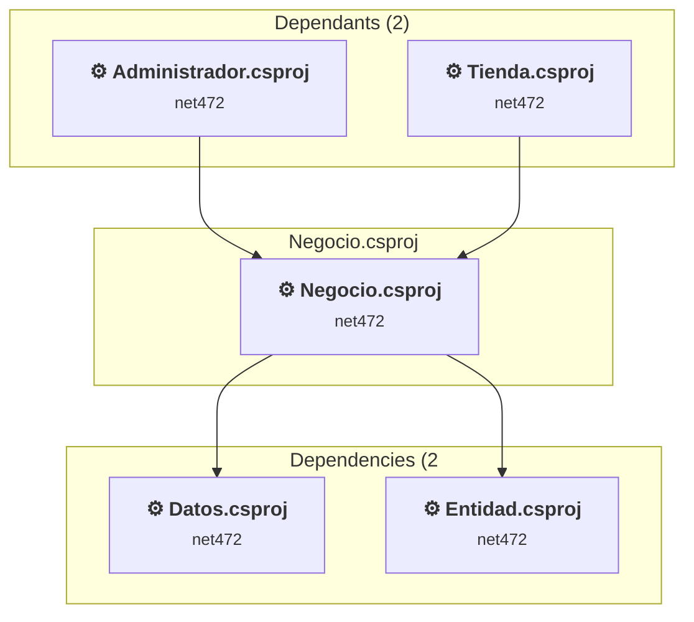
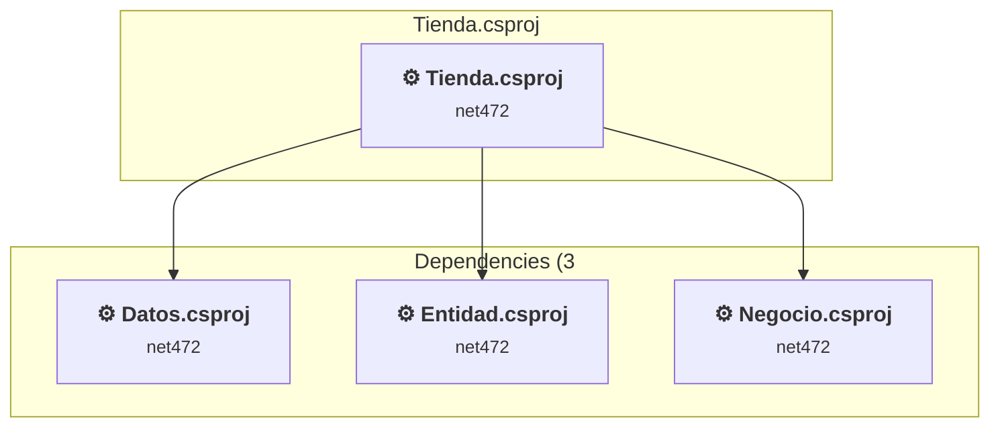

# Projects and dependencies analysis

This document provides a comprehensive overview of the projects and their dependencies in the context of upgrading to .NETCoreApp,Version=v10.0.

## Table of Contents

- [Executive Summary](#executive-Summary)
  - [Highlevel Metrics](#highlevel-metrics)
  - [Projects Compatibility](#projects-compatibility)
  - [Package Compatibility](#package-compatibility)
  - [API Compatibility](#api-compatibility)
  - [Binding Redirect Configuration](#binding-redirect-configuration)
- [Aggregate NuGet packages details](#aggregate-nuget-packages-details)
- [Top API Migration Challenges](#top-api-migration-challenges)
  - [Technologies and Features](#technologies-and-features)
  - [Most Frequent API Issues](#most-frequent-api-issues)
- [Projects Relationship Graph](#projects-relationship-graph)
- [Project Details](#project-details)

  - [Administrador\Administrador.csproj](#administradoradministradorcsproj)
  - [Datos\Datos.csproj](#datosdatoscsproj)
  - [Entidad\Entidad.csproj](#entidadentidadcsproj)
  - [Negocio\Negocio.csproj](#negocionegociocsproj)
  - [Tienda\Tienda.csproj](#tiendatiendacsproj)

## Executive Summary

### Highlevel Metrics

| Metric | Count | Status |
| :--- | :---: | :--- |
| Total Projects | 5 | All require upgrade |
| Total NuGet Packages | 42 | 8 need upgrade |
| Total Code Files | 78 |  |
| Total Code Files with Incidents | 31 |  |
| Total Lines of Code | 13748 |  |
| Total Number of Issues | 1764 |  |
| Estimated LOC to modify | 1658+ | at least 12,1% of codebase |

### Projects Compatibility

| Project | Target Framework | Difficulty | Package Issues | API Issues | Binding Issues | Est. LOC Impact | Description |
| :--- | :---: | :---: | :---: | :---: | :---: | :---: | :--- |
| [Administrador\Administrador.csproj](#administradoradministradorcsproj) | net472 | 🔴 High | 19 | 280 | 23 | 280+ | Wap, Sdk Style = False |
| [Datos\Datos.csproj](#datosdatoscsproj) | net472 | 🟢 Low | 0 | 996 | 0 | 996+ | ClassicClassLibrary, Sdk Style = False |
| [Entidad\Entidad.csproj](#entidadentidadcsproj) | net472 | 🟢 Low | 0 | 0 | 0 |  | ClassicClassLibrary, Sdk Style = False |
| [Negocio\Negocio.csproj](#negocionegociocsproj) | net472 | 🟢 Low | 0 | 0 | 0 |  | ClassicClassLibrary, Sdk Style = False |
| [Tienda\Tienda.csproj](#tiendatiendacsproj) | net472 | 🔴 High | 19 | 382 | 22 | 382+ | Wap, Sdk Style = False |

### Package Compatibility

| Status | Count | Percentage |
| :--- | :---: | :---: |
| ✅ Compatible | 34 | 81,0% |
| ⚠️ Incompatible | 5 | 11,9% |
| 🔄 Upgrade Recommended | 3 | 7,1% |
| ***Total NuGet Packages*** | ***42*** | ***100%*** |

### API Compatibility

| Category | Count | Impact |
| :--- | :---: | :--- |
| 🔴 Binary Incompatible | 578 | High - Require code changes |
| 🟡 Source Incompatible | 1080 | Medium - Needs re-compilation and potential conflicting API error fixing |
| 🔵 Behavioral change | 0 | Low - Behavioral changes that may require testing at runtime |
| ✅ Compatible | 2572 |  |
| ***Total APIs Analyzed*** | ***4230*** |  |

### Binding Redirect Configuration

| Severity | Count | Description |
| :--- | :---: | :--- |
| 🔴Mandatory | 16 | Must be fixed to avoid runtime failures |
| 🟡Potential | 29 | May cause issues in certain scenarios |
| ***Total Binding Issues*** | ***45*** | ***Across 2 project(s)*** |

## Aggregate NuGet packages details

| Package | Current Version | Suggested Version | Projects | Description |
| :--- | :---: | :---: | :--- | :--- |
| AngleSharp | 0.17.1 | 1.8.4 | [Administrador.csproj](#administradoradministradorcsproj) [Tienda.csproj](#tiendatiendacsproj) | El paquete NuGet contiene una vulnerabilidad de seguridad. |
| AngleSharp.Css | 0.17.0 |  | [Administrador.csproj](#administradoradministradorcsproj) [Tienda.csproj](#tiendatiendacsproj) | ✅Compatible |
| Antlr | 3.5.0.2 |  | [Administrador.csproj](#administradoradministradorcsproj) [Tienda.csproj](#tiendatiendacsproj) | Needs to be replaced with Replace with new package Antlr4=4.6.6 |
| bootstrap | 5.3.8 |  | [Administrador.csproj](#administradoradministradorcsproj) [Tienda.csproj](#tiendatiendacsproj) | ✅Compatible |
| ClosedXML | 0.105.0 |  | [Administrador.csproj](#administradoradministradorcsproj) [Tienda.csproj](#tiendatiendacsproj) | ✅Compatible |
| ClosedXML.Parser | 2.0.0 |  | [Administrador.csproj](#administradoradministradorcsproj) [Tienda.csproj](#tiendatiendacsproj) | ✅Compatible |
| DocumentFormat.OpenXml | 3.4.1 |  | [Administrador.csproj](#administradoradministradorcsproj) [Tienda.csproj](#tiendatiendacsproj) | ✅Compatible |
| DocumentFormat.OpenXml.Framework | 3.4.1 |  | [Administrador.csproj](#administradoradministradorcsproj) [Tienda.csproj](#tiendatiendacsproj) | ✅Compatible |
| ExcelNumberFormat | 1.1.0 |  | [Administrador.csproj](#administradoradministradorcsproj) [Tienda.csproj](#tiendatiendacsproj) | ✅Compatible |
| Font.Awesome | 5.15.4 |  | [Administrador.csproj](#administradoradministradorcsproj) | ✅Compatible |
| HtmlSanitizer | 9.0.892 |  | [Administrador.csproj](#administradoradministradorcsproj) [Tienda.csproj](#tiendatiendacsproj) | ✅Compatible |
| jQuery | 3.7.1 |  | [Administrador.csproj](#administradoradministradorcsproj) [Tienda.csproj](#tiendatiendacsproj) | ✅Compatible |
| jquery.datatables | 1.10.15 |  | [Administrador.csproj](#administradoradministradorcsproj) | ✅Compatible |
| jQuery.LoadingOverlay | 2.1.5 |  | [Administrador.csproj](#administradoradministradorcsproj) | ✅Compatible |
| jQuery.UI.Combined | 1.14.1 |  | [Administrador.csproj](#administradoradministradorcsproj) [Tienda.csproj](#tiendatiendacsproj) | ✅Compatible |
| jQuery.Validation | 1.21.0 |  | [Administrador.csproj](#administradoradministradorcsproj) [Tienda.csproj](#tiendatiendacsproj) | ✅Compatible |
| Material.Icons | 2.4.1 |  | [Administrador.csproj](#administradoradministradorcsproj) | ✅Compatible |
| Microsoft.AspNet.Mvc | 5.3.0 |  | [Administrador.csproj](#administradoradministradorcsproj) [Tienda.csproj](#tiendatiendacsproj) | La funcionalidad del paquete NuGet se incluye con la referencia del marco |
| Microsoft.AspNet.Mvc.es | 5.3.0 |  | [Administrador.csproj](#administradoradministradorcsproj) [Tienda.csproj](#tiendatiendacsproj) | ⚠️El paquete NuGet no es compatible |
| Microsoft.AspNet.Razor | 3.3.0 |  | [Administrador.csproj](#administradoradministradorcsproj) [Tienda.csproj](#tiendatiendacsproj) | La funcionalidad del paquete NuGet se incluye con la referencia del marco |
| Microsoft.AspNet.Razor.es | 3.3.0 |  | [Administrador.csproj](#administradoradministradorcsproj) [Tienda.csproj](#tiendatiendacsproj) | ⚠️El paquete NuGet no es compatible |
| Microsoft.AspNet.Web.Optimization | 1.1.3 |  | [Administrador.csproj](#administradoradministradorcsproj) [Tienda.csproj](#tiendatiendacsproj) | ⚠️El paquete NuGet no es compatible |
| Microsoft.AspNet.Web.Optimization.es | 1.1.3 |  | [Administrador.csproj](#administradoradministradorcsproj) [Tienda.csproj](#tiendatiendacsproj) | ⚠️El paquete NuGet no es compatible |
| Microsoft.AspNet.WebPages | 3.3.0 |  | [Administrador.csproj](#administradoradministradorcsproj) [Tienda.csproj](#tiendatiendacsproj) | La funcionalidad del paquete NuGet se incluye con la referencia del marco |
| Microsoft.AspNet.WebPages.es | 3.3.0 |  | [Administrador.csproj](#administradoradministradorcsproj) [Tienda.csproj](#tiendatiendacsproj) | ⚠️El paquete NuGet no es compatible |
| Microsoft.Bcl.HashCode | 6.0.0 |  | [Administrador.csproj](#administradoradministradorcsproj) [Tienda.csproj](#tiendatiendacsproj) | ✅Compatible |
| Microsoft.CodeDom.Providers.DotNetCompilerPlatform | 4.1.0 |  | [Administrador.csproj](#administradoradministradorcsproj) [Tienda.csproj](#tiendatiendacsproj) | La funcionalidad del paquete NuGet se incluye con la referencia del marco |
| Microsoft.jQuery.Unobtrusive.Validation | 4.0.0 |  | [Administrador.csproj](#administradoradministradorcsproj) [Tienda.csproj](#tiendatiendacsproj) | ✅Compatible |
| Microsoft.Web.Infrastructure | 2.0.0 |  | [Administrador.csproj](#administradoradministradorcsproj) [Tienda.csproj](#tiendatiendacsproj) | La funcionalidad del paquete NuGet se incluye con la referencia del marco |
| Modernizr | 2.8.3 |  | [Administrador.csproj](#administradoradministradorcsproj) [Tienda.csproj](#tiendatiendacsproj) | ✅Compatible |
| Newtonsoft.Json | 13.0.4 |  | [Administrador.csproj](#administradoradministradorcsproj) [Tienda.csproj](#tiendatiendacsproj) | ✅Compatible |
| RBush.Signed | 4.0.0 |  | [Administrador.csproj](#administradoradministradorcsproj) [Tienda.csproj](#tiendatiendacsproj) | ✅Compatible |
| SixLabors.Fonts | 1.0.0 |  | [Administrador.csproj](#administradoradministradorcsproj) [Tienda.csproj](#tiendatiendacsproj) | ✅Compatible |
| SweetAlert | 1.0.0 |  | [Administrador.csproj](#administradoradministradorcsproj) | ✅Compatible |
| System.Buffers | 4.6.1 |  | [Administrador.csproj](#administradoradministradorcsproj) [Tienda.csproj](#tiendatiendacsproj) | La funcionalidad del paquete NuGet se incluye con la referencia del marco |
| System.Collections.Immutable | 10.0.2 | 10.0.12 | [Administrador.csproj](#administradoradministradorcsproj) [Tienda.csproj](#tiendatiendacsproj) | Se recomienda actualizar el paquete NuGet |
| System.Memory | 4.6.3 |  | [Administrador.csproj](#administradoradministradorcsproj) [Tienda.csproj](#tiendatiendacsproj) | La funcionalidad del paquete NuGet se incluye con la referencia del marco |
| System.Numerics.Vectors | 4.6.1 |  | [Administrador.csproj](#administradoradministradorcsproj) [Tienda.csproj](#tiendatiendacsproj) | La funcionalidad del paquete NuGet se incluye con la referencia del marco |
| System.Runtime.CompilerServices.Unsafe | 6.1.2 |  | [Administrador.csproj](#administradoradministradorcsproj) [Tienda.csproj](#tiendatiendacsproj) | ✅Compatible |
| System.Text.Encoding.CodePages | 10.0.2 | 10.0.12 | [Administrador.csproj](#administradoradministradorcsproj) [Tienda.csproj](#tiendatiendacsproj) | Se recomienda actualizar el paquete NuGet |
| System.ValueTuple | 4.6.1 |  | [Administrador.csproj](#administradoradministradorcsproj) [Tienda.csproj](#tiendatiendacsproj) | La funcionalidad del paquete NuGet se incluye con la referencia del marco |
| WebGrease | 1.6.0 |  | [Administrador.csproj](#administradoradministradorcsproj) [Tienda.csproj](#tiendatiendacsproj) | ✅Compatible |

## Top API Migration Challenges

### Technologies and Features

| Technology | Issues | Percentage | Migration Path |
| :--- | :---: | :---: | :--- |
| ASP.NET Framework (System.Web) | 614 | 37,0% | Legacy ASP.NET Framework APIs for web applications (System.Web.*) that don't exist in ASP.NET Core due to architectural differences. ASP.NET Core represents a complete redesign of the web framework. Migrate to ASP.NET Core equivalents or consider System.Web.Adapters package for compatibility. |

### Most Frequent API Issues

| API | Count | Percentage | Category |
| :--- | :---: | :---: | :--- |
| T:System.Data.SqlClient.SqlParameterCollection | 145 | 8,7% | Source Incompatible |
| P:System.Data.SqlClient.SqlCommand.Parameters | 145 | 8,7% | Source Incompatible |
| T:System.Data.SqlClient.SqlParameter | 145 | 8,7% | Source Incompatible |
| P:System.Data.SqlClient.SqlDataReader.Item(System.String) | 90 | 5,4% | Source Incompatible |
| M:System.Data.SqlClient.SqlParameterCollection.AddWithValue(System.String,System.Object) | 84 | 5,1% | Source Incompatible |
| T:System.Web.Mvc.JsonRequestBehavior | 74 | 4,5% | Binary Incompatible |
| T:System.Web.Mvc.JsonResult | 64 | 3,9% | Binary Incompatible |
| M:System.Data.SqlClient.SqlConnection.Open | 40 | 2,4% | Source Incompatible |
| T:System.Data.SqlClient.SqlCommand | 40 | 2,4% | Source Incompatible |
| M:System.Data.SqlClient.SqlCommand.#ctor(System.String,System.Data.SqlClient.SqlConnection) | 40 | 2,4% | Source Incompatible |
| T:System.Data.SqlClient.SqlConnection | 40 | 2,4% | Source Incompatible |
| M:System.Data.SqlClient.SqlConnection.#ctor(System.String) | 40 | 2,4% | Source Incompatible |
| F:System.Web.Mvc.JsonRequestBehavior.AllowGet | 37 | 2,2% | Binary Incompatible |
| M:System.Web.Mvc.Controller.Json(System.Object,System.Web.Mvc.JsonRequestBehavior) | 37 | 2,2% | Binary Incompatible |
| P:System.Data.SqlClient.SqlCommand.CommandType | 35 | 2,1% | Source Incompatible |
| P:System.Data.SqlClient.SqlParameterCollection.Item(System.String) | 31 | 1,9% | Source Incompatible |
| P:System.Data.SqlClient.SqlParameter.Value | 31 | 1,9% | Source Incompatible |
| P:System.Data.SqlClient.SqlParameter.Direction | 30 | 1,8% | Source Incompatible |
| T:System.Web.Mvc.ViewResult | 27 | 1,6% | Binary Incompatible |
| M:System.Web.Mvc.HttpPostAttribute.#ctor | 27 | 1,6% | Binary Incompatible |
| T:System.Web.Mvc.HttpPostAttribute | 27 | 1,6% | Binary Incompatible |
| T:System.Web.Mvc.ActionResult | 25 | 1,5% | Binary Incompatible |
| M:System.Web.Mvc.Controller.View | 25 | 1,5% | Binary Incompatible |
| M:System.Data.SqlClient.SqlCommand.ExecuteNonQuery | 22 | 1,3% | Source Incompatible |
| M:System.Data.SqlClient.SqlDataReader.Read | 17 | 1,0% | Source Incompatible |
| T:System.Data.SqlClient.SqlDataReader | 17 | 1,0% | Source Incompatible |
| M:System.Data.SqlClient.SqlCommand.ExecuteReader | 17 | 1,0% | Source Incompatible |
| M:System.Data.SqlClient.SqlParameterCollection.Add(System.String,System.Data.SqlDbType) | 16 | 1,0% | Source Incompatible |
| T:System.Web.Optimization.Bundle | 15 | 0,9% | Binary Incompatible |
| T:System.Web.HttpSessionStateBase | 15 | 0,9% | Source Incompatible |
| P:System.Web.Mvc.Controller.Session | 15 | 0,9% | Binary Incompatible |
| P:System.Web.HttpSessionStateBase.Item(System.String) | 15 | 0,9% | Source Incompatible |
| T:System.Web.Mvc.RedirectToRouteResult | 14 | 0,8% | Binary Incompatible |
| M:System.Data.SqlClient.SqlParameterCollection.Add(System.String,System.Data.SqlDbType,System.Int32) | 14 | 0,8% | Source Incompatible |
| P:System.Web.Mvc.ControllerBase.ViewBag | 11 | 0,7% | Binary Incompatible |
| M:System.Web.Mvc.Controller.RedirectToAction(System.String) | 10 | 0,6% | Binary Incompatible |
| M:System.Web.Optimization.BundleCollection.Add(System.Web.Optimization.Bundle) | 10 | 0,6% | Binary Incompatible |
| T:System.Web.Mvc.TempDataDictionary | 9 | 0,5% | Binary Incompatible |
| P:System.Web.Mvc.ControllerBase.TempData | 9 | 0,5% | Binary Incompatible |
| P:System.Web.Mvc.TempDataDictionary.Item(System.String) | 9 | 0,5% | Binary Incompatible |
| M:System.Web.Mvc.HttpGetAttribute.#ctor | 8 | 0,5% | Binary Incompatible |
| T:System.Web.Mvc.HttpGetAttribute | 8 | 0,5% | Binary Incompatible |
| M:System.Web.Mvc.Controller.#ctor | 6 | 0,4% | Binary Incompatible |
| T:System.Web.Mvc.Controller | 6 | 0,4% | Binary Incompatible |
| M:System.Web.Optimization.Bundle.Include(System.String,System.Web.Optimization.IItemTransform[]) | 6 | 0,4% | Binary Incompatible |
| T:System.Web.Mvc.UrlParameter | 6 | 0,4% | Binary Incompatible |
| M:System.Web.Optimization.Bundle.#ctor(System.String) | 5 | 0,3% | Binary Incompatible |
| T:System.Web.Security.FormsAuthentication | 4 | 0,2% | Binary Incompatible |
| M:System.Web.Mvc.Controller.RedirectToAction(System.String,System.String) | 4 | 0,2% | Binary Incompatible |
| T:System.Web.Optimization.BundleCollection | 4 | 0,2% | Binary Incompatible |

## Projects Relationship Graph

Legend:
📦 SDK-style project
⚙️ Classic project

## Project Details

### Administrador\Administrador.csproj

#### Project Info

- **Current Target Framework:** net472
- **Proposed Target Framework:** net10.0
- **SDK-style**: False
- **Project Kind:** Wap
- **Dependencies**: 2
- **Dependants**: 0
- **Number of Files**: 419
- **Number of Files with Incidents**: 11
- **Lines of Code**: 3174
- **Estimated LOC to modify**: 280+ (at least 8,8% of the project)

#### Dependency Graph

Legend:
📦 SDK-style project
⚙️ Classic project

### API Compatibility

| Category | Count | Impact |
| :--- | :---: | :--- |
| 🔴 Binary Incompatible | 273 | High - Require code changes |
| 🟡 Source Incompatible | 7 | Medium - Needs re-compilation and potential conflicting API error fixing |
| 🔵 Behavioral change | 0 | Low - Behavioral changes that may require testing at runtime |
| ✅ Compatible | 267 |  |
| ***Total APIs Analyzed*** | ***547*** |  |

#### Binding Redirect Configuration

| Rule | Severity | Details | Recommendation |
| :--- | :---: | :--- | :--- |
| Missing binding redirect for referenced assembly | 🟡Potential | Manual redirects exist but none covers AngleSharp.Css (referenced v0.17.0.0, package v0.17.0) | Add a binding redirect for the missing assembly. |
| Missing binding redirect for referenced assembly | 🟡Potential | Manual redirects exist but none covers ClosedXML (referenced v0.105.0.0, package v0.105.0) | Add a binding redirect for the missing assembly. |
| Missing binding redirect for referenced assembly | 🟡Potential | Manual redirects exist but none covers ClosedXML.Parser (referenced v1.0.0.0, package v2.0.0) | Add a binding redirect for the missing assembly. |
| Missing binding redirect for referenced assembly | 🟡Potential | Manual redirects exist but none covers ExcelNumberFormat (referenced v1.1.0.0, package v1.1.0) | Add a binding redirect for the missing assembly. |
| Missing binding redirect for referenced assembly | 🟡Potential | Manual redirects exist but none covers HtmlSanitizer (referenced v9.0.0.0, package v9.0.892) | Add a binding redirect for the missing assembly. |
| Missing binding redirect for referenced assembly | 🟡Potential | Manual redirects exist but none covers Material.Icons (referenced v2.4.1.0, package v2.4.1) | Add a binding redirect for the missing assembly. |
| Missing binding redirect for referenced assembly | 🟡Potential | Manual redirects exist but none covers Microsoft.CodeDom.Providers.DotNetCompilerPlatform (referenced v4.1.0.0, package v4.1.0) | Add a binding redirect for the missing assembly. |
| Missing binding redirect for referenced assembly | 🟡Potential | Manual redirects exist but none covers SixLabors.Fonts (referenced v1.0.0.0, package v1.0.0) | Add a binding redirect for the missing assembly. |
| Manual redirect conflicts with auto-generated version | 🔴Mandatory | Manual redirect for Newtonsoft.Json targets 13.0.0.0 but auto-generation would target 13.0.4 (MSB3836 conflict) | Remove the conflicting manual binding redirect or disable auto-generation. |
| Manual redirect conflicts with auto-generated version | 🔴Mandatory | Manual redirect for WebGrease targets 1.6.5135.21930 but auto-generation would target 1.6.0 (MSB3836 conflict) | Remove the conflicting manual binding redirect or disable auto-generation. |
| Manual redirect conflicts with auto-generated version | 🔴Mandatory | Manual redirect for System.Runtime.CompilerServices.Unsafe targets 6.0.3.0 but auto-generation would target 6.1.2 (MSB3836 conflict) | Remove the conflicting manual binding redirect or disable auto-generation. |
| Manual redirect conflicts with auto-generated version | 🔴Mandatory | Manual redirect for System.Memory targets 4.0.5.0 but auto-generation would target 4.6.3 (MSB3836 conflict) | Remove the conflicting manual binding redirect or disable auto-generation. |
| Manual redirect conflicts with auto-generated version | 🔴Mandatory | Manual redirect for System.Numerics.Vectors targets 4.1.6.0 but auto-generation would target 4.6.1 (MSB3836 conflict) | Remove the conflicting manual binding redirect or disable auto-generation. |
| Manual redirect conflicts with auto-generated version | 🔴Mandatory | Manual redirect for System.Buffers targets 4.0.5.0 but auto-generation would target 4.6.1 (MSB3836 conflict) | Remove the conflicting manual binding redirect or disable auto-generation. |
| Manual redirect conflicts with auto-generated version | 🔴Mandatory | Manual redirect for System.Text.Encoding.CodePages targets 10.0.0.2 but auto-generation would target 10.0.2 (MSB3836 conflict) | Remove the conflicting manual binding redirect or disable auto-generation. |
| Manual redirect conflicts with auto-generated version | 🔴Mandatory | Manual redirect for System.Collections.Immutable targets 10.0.0.2 but auto-generation would target 10.0.2 (MSB3836 conflict) | Remove the conflicting manual binding redirect or disable auto-generation. |
| Binding redirect forces version downgrade | 🟡Potential | Binding redirect for Newtonsoft.Json targets 13.0.0.0 but package provides 13.0.4 | Update the binding redirect newVersion to match the version provided by the NuGet package. |
| Binding redirect forces version downgrade | 🟡Potential | Binding redirect for System.Buffers targets 4.0.5.0 but package provides 4.6.1 | Update the binding redirect newVersion to match the version provided by the NuGet package. |
| Binding redirect forces version downgrade | 🟡Potential | Binding redirect for System.Collections.Immutable targets 10.0.0.2 but package provides 10.0.2 | Update the binding redirect newVersion to match the version provided by the NuGet package. |
| Binding redirect forces version downgrade | 🟡Potential | Binding redirect for System.Memory targets 4.0.5.0 but package provides 4.6.3 | Update the binding redirect newVersion to match the version provided by the NuGet package. |
| Binding redirect forces version downgrade | 🟡Potential | Binding redirect for System.Numerics.Vectors targets 4.1.6.0 but package provides 4.6.1 | Update the binding redirect newVersion to match the version provided by the NuGet package. |
| Binding redirect forces version downgrade | 🟡Potential | Binding redirect for System.Runtime.CompilerServices.Unsafe targets 6.0.3.0 but package provides 6.1.2 | Update the binding redirect newVersion to match the version provided by the NuGet package. |
| Binding redirect forces version downgrade | 🟡Potential | Binding redirect for System.Text.Encoding.CodePages targets 10.0.0.2 but package provides 10.0.2 | Update the binding redirect newVersion to match the version provided by the NuGet package. |

#### Project Technologies and Features

| Technology | Issues | Percentage | Migration Path |
| :--- | :---: | :---: | :--- |
| ASP.NET Framework (System.Web) | 280 | 100,0% | Legacy ASP.NET Framework APIs for web applications (System.Web.*) that don't exist in ASP.NET Core due to architectural differences. ASP.NET Core represents a complete redesign of the web framework. Migrate to ASP.NET Core equivalents or consider System.Web.Adapters package for compatibility. |

### Datos\Datos.csproj

#### Project Info

- **Current Target Framework:** net472
- **Proposed Target Framework:** net10.0
- **SDK-style**: False
- **Project Kind:** ClassicClassLibrary
- **Dependencies**: 1
- **Dependants**: 2
- **Number of Files**: 11
- **Number of Files with Incidents**: 10
- **Lines of Code**: 1271
- **Estimated LOC to modify**: 996+ (at least 78,4% of the project)

#### Dependency Graph

Legend:
📦 SDK-style project
⚙️ Classic project

### API Compatibility

| Category | Count | Impact |
| :--- | :---: | :--- |
| 🔴 Binary Incompatible | 0 | High - Require code changes |
| 🟡 Source Incompatible | 996 | Medium - Needs re-compilation and potential conflicting API error fixing |
| 🔵 Behavioral change | 0 | Low - Behavioral changes that may require testing at runtime |
| ✅ Compatible | 1344 |  |
| ***Total APIs Analyzed*** | ***2340*** |  |

### Entidad\Entidad.csproj

#### Project Info

- **Current Target Framework:** net472
- **Proposed Target Framework:** net10.0
- **SDK-style**: False
- **Project Kind:** ClassicClassLibrary
- **Dependencies**: 0
- **Dependants**: 4
- **Number of Files**: 18
- **Number of Files with Incidents**: 1
- **Lines of Code**: 308
- **Estimated LOC to modify**: 0+ (at least 0,0% of the project)

#### Dependency Graph

Legend:
📦 SDK-style project
⚙️ Classic project

### API Compatibility

| Category | Count | Impact |
| :--- | :---: | :--- |
| 🔴 Binary Incompatible | 0 | High - Require code changes |
| 🟡 Source Incompatible | 0 | Medium - Needs re-compilation and potential conflicting API error fixing |
| 🔵 Behavioral change | 0 | Low - Behavioral changes that may require testing at runtime |
| ✅ Compatible | 261 |  |
| ***Total APIs Analyzed*** | ***261*** |  |

### Negocio\Negocio.csproj

#### Project Info

- **Current Target Framework:** net472
- **Proposed Target Framework:** net10.0
- **SDK-style**: False
- **Project Kind:** ClassicClassLibrary
- **Dependencies**: 2
- **Dependants**: 2
- **Number of Files**: 11
- **Number of Files with Incidents**: 1
- **Lines of Code**: 588
- **Estimated LOC to modify**: 0+ (at least 0,0% of the project)

#### Dependency Graph

Legend:
📦 SDK-style project
⚙️ Classic project

### API Compatibility

| Category | Count | Impact |
| :--- | :---: | :--- |
| 🔴 Binary Incompatible | 0 | High - Require code changes |
| 🟡 Source Incompatible | 0 | Medium - Needs re-compilation and potential conflicting API error fixing |
| 🔵 Behavioral change | 0 | Low - Behavioral changes that may require testing at runtime |
| ✅ Compatible | 380 |  |
| ***Total APIs Analyzed*** | ***380*** |  |

### Tienda\Tienda.csproj

#### Project Info

- **Current Target Framework:** net472
- **Proposed Target Framework:** net10.0
- **SDK-style**: False
- **Project Kind:** Wap
- **Dependencies**: 3
- **Dependants**: 0
- **Number of Files**: 125
- **Number of Files with Incidents**: 8
- **Lines of Code**: 8407
- **Estimated LOC to modify**: 382+ (at least 4,5% of the project)

#### Dependency Graph

Legend:
📦 SDK-style project
⚙️ Classic project

### API Compatibility

| Category | Count | Impact |
| :--- | :---: | :--- |
| 🔴 Binary Incompatible | 305 | High - Require code changes |
| 🟡 Source Incompatible | 77 | Medium - Needs re-compilation and potential conflicting API error fixing |
| 🔵 Behavioral change | 0 | Low - Behavioral changes that may require testing at runtime |
| ✅ Compatible | 320 |  |
| ***Total APIs Analyzed*** | ***702*** |  |

#### Binding Redirect Configuration

| Rule | Severity | Details | Recommendation |
| :--- | :---: | :--- | :--- |
| Missing binding redirect for referenced assembly | 🟡Potential | Manual redirects exist but none covers AngleSharp.Css (referenced v0.17.0.0, package v0.17.0) | Add a binding redirect for the missing assembly. |
| Missing binding redirect for referenced assembly | 🟡Potential | Manual redirects exist but none covers ClosedXML (referenced v0.105.0.0, package v0.105.0) | Add a binding redirect for the missing assembly. |
| Missing binding redirect for referenced assembly | 🟡Potential | Manual redirects exist but none covers ClosedXML.Parser (referenced v1.0.0.0, package v2.0.0) | Add a binding redirect for the missing assembly. |
| Missing binding redirect for referenced assembly | 🟡Potential | Manual redirects exist but none covers ExcelNumberFormat (referenced v1.1.0.0, package v1.1.0) | Add a binding redirect for the missing assembly. |
| Missing binding redirect for referenced assembly | 🟡Potential | Manual redirects exist but none covers HtmlSanitizer (referenced v9.0.0.0, package v9.0.892) | Add a binding redirect for the missing assembly. |
| Missing binding redirect for referenced assembly | 🟡Potential | Manual redirects exist but none covers Microsoft.CodeDom.Providers.DotNetCompilerPlatform (referenced v4.1.0.0, package v4.1.0) | Add a binding redirect for the missing assembly. |
| Missing binding redirect for referenced assembly | 🟡Potential | Manual redirects exist but none covers SixLabors.Fonts (referenced v1.0.0.0, package v1.0.0) | Add a binding redirect for the missing assembly. |
| Manual redirect conflicts with auto-generated version | 🔴Mandatory | Manual redirect for Newtonsoft.Json targets 13.0.0.0 but auto-generation would target 13.0.4 (MSB3836 conflict) | Remove the conflicting manual binding redirect or disable auto-generation. |
| Manual redirect conflicts with auto-generated version | 🔴Mandatory | Manual redirect for WebGrease targets 1.6.5135.21930 but auto-generation would target 1.6.0 (MSB3836 conflict) | Remove the conflicting manual binding redirect or disable auto-generation. |
| Manual redirect conflicts with auto-generated version | 🔴Mandatory | Manual redirect for System.Runtime.CompilerServices.Unsafe targets 6.0.3.0 but auto-generation would target 6.1.2 (MSB3836 conflict) | Remove the conflicting manual binding redirect or disable auto-generation. |
| Manual redirect conflicts with auto-generated version | 🔴Mandatory | Manual redirect for System.Memory targets 4.0.5.0 but auto-generation would target 4.6.3 (MSB3836 conflict) | Remove the conflicting manual binding redirect or disable auto-generation. |
| Manual redirect conflicts with auto-generated version | 🔴Mandatory | Manual redirect for System.Numerics.Vectors targets 4.1.6.0 but auto-generation would target 4.6.1 (MSB3836 conflict) | Remove the conflicting manual binding redirect or disable auto-generation. |
| Manual redirect conflicts with auto-generated version | 🔴Mandatory | Manual redirect for System.Buffers targets 4.0.5.0 but auto-generation would target 4.6.1 (MSB3836 conflict) | Remove the conflicting manual binding redirect or disable auto-generation. |
| Manual redirect conflicts with auto-generated version | 🔴Mandatory | Manual redirect for System.Text.Encoding.CodePages targets 10.0.0.2 but auto-generation would target 10.0.2 (MSB3836 conflict) | Remove the conflicting manual binding redirect or disable auto-generation. |
| Manual redirect conflicts with auto-generated version | 🔴Mandatory | Manual redirect for System.Collections.Immutable targets 10.0.0.2 but auto-generation would target 10.0.2 (MSB3836 conflict) | Remove the conflicting manual binding redirect or disable auto-generation. |
| Binding redirect forces version downgrade | 🟡Potential | Binding redirect for Newtonsoft.Json targets 13.0.0.0 but package provides 13.0.4 | Update the binding redirect newVersion to match the version provided by the NuGet package. |
| Binding redirect forces version downgrade | 🟡Potential | Binding redirect for System.Buffers targets 4.0.5.0 but package provides 4.6.1 | Update the binding redirect newVersion to match the version provided by the NuGet package. |
| Binding redirect forces version downgrade | 🟡Potential | Binding redirect for System.Collections.Immutable targets 10.0.0.2 but package provides 10.0.2 | Update the binding redirect newVersion to match the version provided by the NuGet package. |
| Binding redirect forces version downgrade | 🟡Potential | Binding redirect for System.Memory targets 4.0.5.0 but package provides 4.6.3 | Update the binding redirect newVersion to match the version provided by the NuGet package. |
| Binding redirect forces version downgrade | 🟡Potential | Binding redirect for System.Numerics.Vectors targets 4.1.6.0 but package provides 4.6.1 | Update the binding redirect newVersion to match the version provided by the NuGet package. |
| Binding redirect forces version downgrade | 🟡Potential | Binding redirect for System.Runtime.CompilerServices.Unsafe targets 6.0.3.0 but package provides 6.1.2 | Update the binding redirect newVersion to match the version provided by the NuGet package. |
| Binding redirect forces version downgrade | 🟡Potential | Binding redirect for System.Text.Encoding.CodePages targets 10.0.0.2 but package provides 10.0.2 | Update the binding redirect newVersion to match the version provided by the NuGet package. |

#### Project Technologies and Features

| Technology | Issues | Percentage | Migration Path |
| :--- | :---: | :---: | :--- |
| ASP.NET Framework (System.Web) | 334 | 87,4% | Legacy ASP.NET Framework APIs for web applications (System.Web.*) that don't exist in ASP.NET Core due to architectural differences. ASP.NET Core represents a complete redesign of the web framework. Migrate to ASP.NET Core equivalents or consider System.Web.Adapters package for compatibility. |

